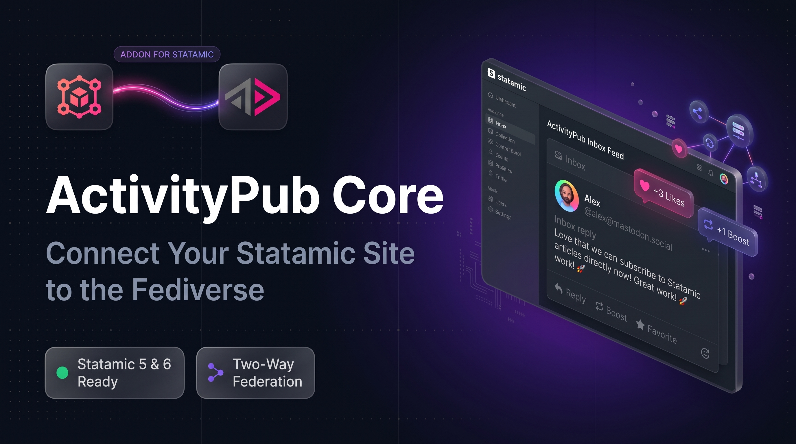
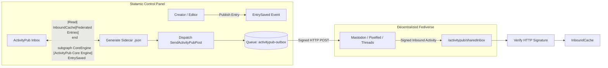
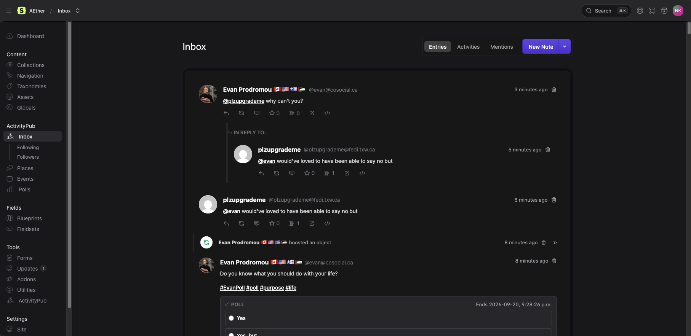
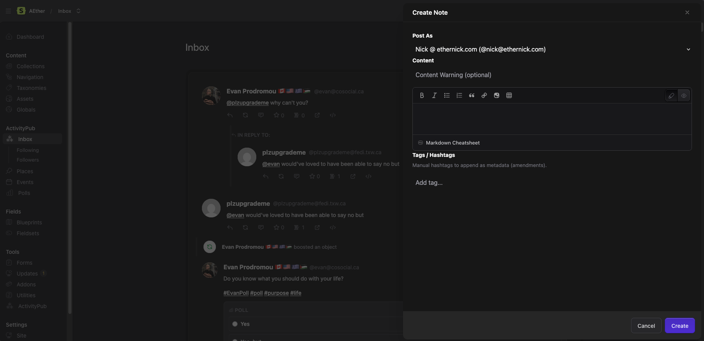
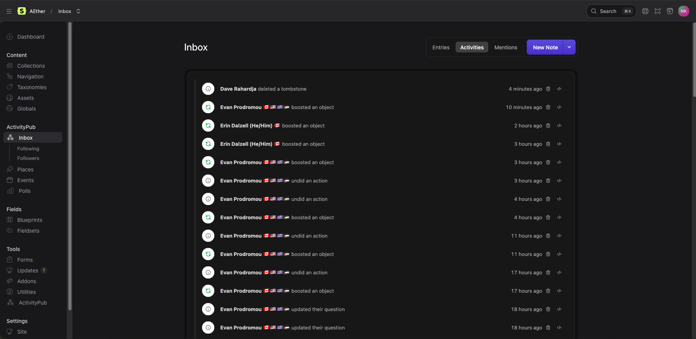
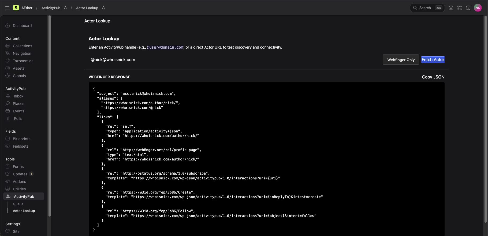
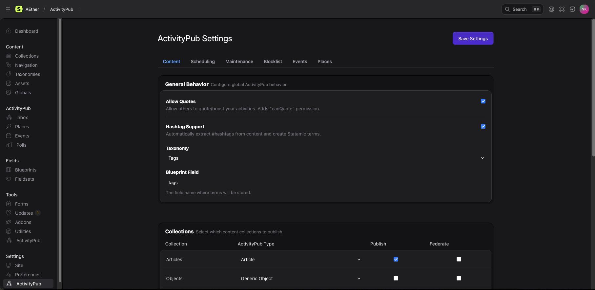
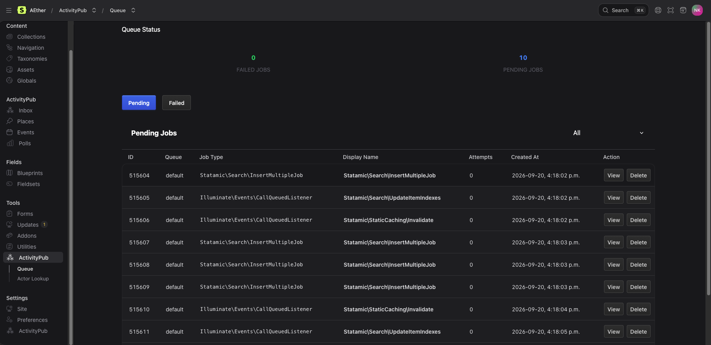

# ActivityPub Core for Statamic

<p align="center">
  
</p>

[](https://statamic.com)
[](CHANGELOG.md)
[](https://php.net)
[](https://w3.org/TR/activitypub/)
[](LICENSE.md)

> [!NOTE]  
> **Pre-Release Milestone (v0.9.0):**  
> ActivityPub Core is feature-complete and undergoing final release gating ahead of official listing on the Statamic Marketplace. Free for local development and non-production testing under our [Commercial Source-Available License](LICENSE.md). Production commercial licensing is **$0 for Single-Actor** sites and **$79 for Multi-Actor / Teams** editions upon official Marketplace launch (includes free upgrade to v1.0.0).

Turn your Statamic site into a fully federated **ActivityPub actor**. Seamlessly syndicate content to Mastodon, Pixelfed, Threads, and the broader Fediverse while receiving follows, likes, replies, and boosts directly inside your Statamic Control Panel.

---

## ✨ Features at a Glance

| Feature | Description |
|---|---|
| 📡 **Two-Way Federation** | Syndicate notes and articles to followers across the Fediverse. Inbound replies, likes, boosts, and follows sync directly back to your site. |
| 🛡️ **Secure HTTP Signatures** | Cryptographic verification via RSA-SHA256 (`Signature` and `Digest` headers) with strict clock-skew mitigation (±300s window). |
| ⚡ **Zero-Bloat Sidecar Storage** | ActivityPub JSON documents are stored in clean `.json` sidecars alongside flat-file Markdown entries, keeping the Statamic Stache blazing fast. |
| 📬 **Native Control Panel Inbox** | Rich interactive stream feed built for both Statamic 5 (Vue 2.7) and Statamic 6 (Vue 3.5) with real-time interaction states. |
| 🎛️ **Background Queue Worker** | Non-blocking distribution with dedicated retry loops, backoff handling, and dead-letter queue (DLQ) tracking via `activitypub-outbox`. |
| 🚫 **Self-Healing & Auto-Block** | Domain and handle-based blocklists with automated auto-blocking on `410 Gone` and instance suspension detection. |
| 🧩 **Modular Addon Ecosystem** | Easily extendable via the `ActivityPubTypes` service registry to support polls, long-form articles, places, or custom schemas. |

---

## 🚀 Quick Start

### 1. Require Package via Composer

```bash
composer require ethernick/statamic-activitypub-core
```

### 2. Publish Configuration & Assets

```bash
php artisan vendor:publish --tag=activitypub-config
php artisan vendor:publish --tag=activitypub-assets
```

### 3. Run Queue Worker

Federation outbox distribution runs asynchronously via Laravel's queue. Ensure your queue worker processes the `activitypub-outbox` queue:

```bash
php artisan queue:work --queue=activitypub-outbox,default
```

---

## 🏛️ System Architecture



---

## 🖼️ Control Panel Experience

| Federated Inbox Feed | Create New Note |
| :---: | :---: |
|  |  |

| Federation Activities Stream | Actor Lookup & Webfinger Discovery |
| :---: | :---: |
|  |  |

| ActivtyPub Addon Settings | Job Queue |
| :---: | :---: |
|  |  |
---

## 🧩 Extension Addons

ActivityPub Core is built to be modular. Expand functionality with dedicated first-party or third-party addons:

- **[ActivityPub Questions](https://github.com/ethernick/statamic-activitypub-questions)** — Adds interactive Fediverse polls and question voting widgets.
- **[ActivityPub Places](https://github.com/ethernick/statamic-activitypub-places)** — Adds location check-ins and `Place` metadata federation.
- **[ActivityPub Events](https://github.com/ethernick/statamic-activitypub-events)** — Adds event calendar & rsvp attendance `Event` metadata federation.

Looking to build your own custom type? Check out the **[Extension Developer Guide (HOOKS.md)](docs/HOOKS.md)**.

---

## 📚 Documentation & Guides

- **[Production Operator & Installation Guide](docs/INSTALLATION.md)** — Step-by-step installation, Supervisor queue setup, and web server (Nginx/Apache/Caddy/Cloudflare) configs.
- **[Troubleshooting & Operations Runbook](docs/TROUBLESHOOTING.md)** — Diagnostic matrix for Webfinger, HTTP signatures, clock skew, and stuck queues.
- **[Federation Best Practices & Performance Guide](docs/FEDERATION_GUIDE.md)** — Actor topologies, auto-block moderation, Redis/DB queues, and retention policies.
- **[Extension Developer Guide](docs/HOOKS.md)** — Registry APIs, lifecycle store hooks, outbox formatters, and Vue injection points.
- **[Frontend Build System](docs/BUILD.md)** — Dual-bundle Vue 2 (Statamic 5) and Vue 3 (Statamic 6) architecture.
- **[Marketplace Launch Blueprint](docs/MARKETPLACE_LAUNCH.md)** — Creative specs, screenshot guides, 15-second video storyboard, and creator onboarding materials.
- **[Task Roadmap & Release Checklist](docs/TASKS.md)** — Active development punch-list and marketplace release milestones.
- **[Product Requirements Document](docs/PRD.md)** — Architectural decisions, domain models, and technical history.

---

## 🤝 Community & Support

- **Bug Reports & Feature Requests**: [Issue Tracker](https://github.com/ethernick/statamic-activitypub-core/issues)
- **Source Code Repository**: [Repository](https://github.com/ethernick/statamic-activitypub-core)
- **Documentation**: [Project Documentation](https://github.com/ethernick/statamic-activitypub-core/docs)

---

## 📄 License

ActivityPub Core for Statamic is source-available software provided under the **[Statamic Commercial License](LICENSE.md)** (free for local development and non-production testing; production usage is **$0 for Single-Actor** and **$79 for Multi-Actor / Teams** editions via the Statamic Marketplace).

## 🦾 AI Disclosure

Parts were written with the help of AI agents including Gemini & Claude. 