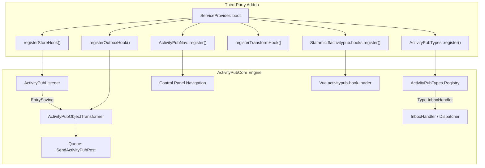
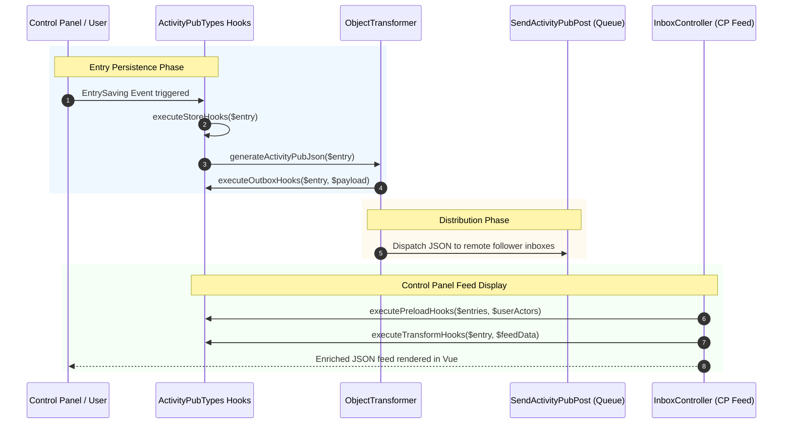

# ActivityPub Extension Developer Guide

`ActivityPubCore` provides an extensible foundation allowing Statamic addons to register custom ActivityStreams types (such as `Article`, `Question`, `Event`, or `Place`), hook into lifecycle events, customize inbound and outbound payloads, extend Control Panel navigation, and inject custom Vue UI components.

---

## Architecture Overview



---

## 1. Type Registration (`ActivityPubTypes`)

The `ActivityPubTypes` service is the central registry for declaring custom ActivityStreams types and mapping them to Statamic content collections, controllers, outbox formatters, and inbox job handlers.

### Method Signature

```php
use Ethernick\ActivityPubCore\Services\ActivityPubTypes;

ActivityPubTypes::register(
    string $key, 
    string $label, 
    ?string $slug = null,
    ?string $controller = null, 
    array $collections = [], 
    ?string $storeHandler = null,
    ?string $outboxHandler = null,
    ?string $inboxHandler = null,
    array $substantiveFields = []
): void;
```

### Parameter Reference

| Parameter | Type | Description | Example |
|---|---|---|---|
| `$key` | `string` | The ActivityStreams type identifier. | `'Event'`, `'Article'`, `'Question'` |
| `$label` | `string` | Human-readable label displayed in the CP. | `'Event'`, `'Long-Form Article'` |
| `$slug` | `?string` | URL / identifier slug override. Defaults to lowercase plural of key. | `'events'`, `'articles'` |
| `$controller` | `?string` | FQCN of the CP controller managing this type. | `EventController::class` |
| `$collections` | `array` | Statamic collection handles associated with this type. | `['events']` |
| `$storeHandler` | `?string` | FQCN of a dedicated handler class or controller action. | `EventStoreHandler::class` |
| `$outboxHandler` | `?string` | FQCN of a class implementing `OutboxHandlerInterface`. | `EventOutboxHandler::class` |
| `$inboxHandler` | `?string` | FQCN of a queued Job or Handler class invoked on incoming activities. | `EventInboxHandler::class` |
| `$substantiveFields` | `array` | Custom fields that represent substantive changes triggering `Update` activities and setting `updated` timestamp (while freezing `published`). | `['options', 'voters_count']` |

> [!NOTE]
> Any collection passed in `$collections` is automatically registered into the ActivityPub Inbox query scope via `ActivityPubTypes::registerInboxCollection()`. Core always tracks substantive changes on base fields (`content`, `title`, `summary`, `sensitive`, `attachments`). Pass addon-specific fields in `$substantiveFields` to ensure background saves (like token indexing or cache warming) do NOT bump dates or emit spammy `Update` activities.

### Overriding or Modifying Existing Types

To modify an existing type without overwriting unrelated configurations:

```php
ActivityPubTypes::modify('Question', [
    'controller' => CustomQuestionController::class,
    'label' => 'Interactive Poll',
]);
```

---

## 2. Backend Lifecycle Hooks

`ActivityPubCore` provides four distinct hook points executed during entry persistence, inbox aggregation, and outbox delivery.



### A. Store Hooks (`registerStoreHook`)
Executes synchronously during Statamic's `EntrySaving` event before the entry is written to disk. Use this to enforce entry slugs, UUIDs, initial defaults, and taxonomy assignments.

```php
ActivityPubTypes::registerStoreHook(function (\Statamic\Entries\Entry $entry) {
    if ($entry->collectionHandle() !== 'events') {
        return;
    }

    // Auto-generate UUID slug if missing
    if (!$entry->id()) {
        $entry->id((string) \Illuminate\Support\Str::uuid());
    }

    // Enforce default event attributes
    if (!$entry->get('start_time')) {
        $entry->set('start_time', now()->toIso8601String());
    }
});
```

### B. Outbox Hooks (`registerOutboxHook`)
Executes during ActivityStreams payload generation when syndicating content to the Fediverse. Outbox hooks support **priorities** (higher numbers execute first).

```php
ActivityPubTypes::registerOutboxHook(function (\Statamic\Entries\Entry $entry, array &$data) {
    if ($entry->collectionHandle() !== 'events') {
        return;
    }

    // Add ActivityStreams Event-specific schema fields
    $data['startTime'] = $entry->get('start_time');
    $data['endTime'] = $entry->get('end_time');
    $data['location'] = [
        'type' => 'Place',
        'name' => $entry->get('location_name'),
        'latitude' => $entry->get('latitude'),
        'longitude' => $entry->get('longitude'),
    ];
}, priority: 20);
```

### C. Outbox Handlers (`OutboxHandlerInterface`)
Instead of closure-based outbox hooks, complex content types can declare dedicated outbox handler classes implementing `Ethernick\ActivityPubCore\Contracts\OutboxHandlerInterface`:

```php
namespace MyOrg\ActivityPubEvents\Handlers;

use Ethernick\ActivityPubCore\Contracts\OutboxHandlerInterface;
use Statamic\Entries\Entry;

class EventOutboxHandler implements OutboxHandlerInterface
{
    public function format(array $data, Entry $entry): array
    {
        $data['type'] = 'Event';
        $data['startTime'] = $entry->get('start_time');
        $data['endTime'] = $entry->get('end_time');

        return $data;
    }
}
```

### D. Inbox Preload Hooks (`registerPreloadHook`)
Fires when the Control Panel Inbox feed loads. Allows addons to perform bulk database queries (e.g. batch fetching likes, votes, or RSVP confirmations) to prevent N+1 query issues when listing items.

```php
ActivityPubTypes::registerPreloadHook(function (array $items, array $userActors) {
    $eventIds = [];
    foreach ($items as $item) {
        if ($item->collection()->handle() === 'events') {
            $eventIds[] = (string) $item->id();
        }
    }

    if (empty($eventIds)) {
        return;
    }

    // Query RSVPs once in bulk and store in a static cache
    MyEventRsvpService::warmCacheForEvents($eventIds, $userActors);
});
```

### E. Inbox Transform Hooks (`registerTransformHook`)
Enriches the JSON representation of an entry sent to the Control Panel Vue feed. Use this to attach UI state, permission flags, or action routes.

```php
ActivityPubTypes::registerTransformHook(function (\Statamic\Entries\Entry $entry, array &$data) {
    if ($entry->collection()->handle() !== 'events') {
        return;
    }

    $data['type'] = 'event';
    $data['start_time'] = $entry->get('start_time');
    $data['attendees_count'] = MyEventRsvpService::getAttendeeCount($entry->id());
    $data['actions']['rsvp'] = cp_route('activitypub.events.rsvp', ['id' => $entry->id()]);
});
```

### F. Broadcast Suppression & Policies (`registerBroadcastPolicy`)

ActivityPub federation delivers `Create`, `Update`, and `Delete` activities to remote instances whenever internal entries change. To control or suppress broadcasting under specific circumstances, addons can use two mechanisms:

#### 1. Contextual Entry Supplement
Any process or job saving an entry can temporarily suppress ActivityPub broadcast without mutating flat-file YAML or Stache state by setting the `activitypub_suppress_broadcast` supplement:

```php
$entry->setSupplement('activitypub_suppress_broadcast', true);
$entry->save();
```

#### 2. Global / Addon Broadcast Policies
Addons can register broadcast policy callbacks via `ActivityPubTypes::registerBroadcastPolicy()`. The policy receives the activity type (`'Create'`, `'Update'`, `'Delete'`) and the entry being processed. Returning `false` suppresses activity generation and delivery:

```php
ActivityPubTypes::registerBroadcastPolicy(function (string $type, $entry) {
    // Suppress broadcasting unlisted or draft questions
    if ($entry->collection()->handle() === 'polls' && $entry->get('visibility') === 'unlisted') {
        return false;
    }

    return true;
});
```

---

## 3. Control Panel Navigation (`ActivityPubNav`)

To integrate custom views or sub-navigation into the ActivityPub section of the Statamic Control Panel, register items via `ActivityPubNav`.

```php
use Ethernick\ActivityPubCore\Services\ActivityPubNav;

ActivityPubNav::register('events', [
    'label'   => 'Events',
    'route'   => 'activitypub.events.index',
    'icon'    => 'calendar',              // Statamic SVG icon handle or raw SVG string
    'order'   => 30,                      // Inbox = 10, Polls = 20, Events = 30
    'section' => 'ActivityPub',
]);
```

---

## 4. Frontend Vue Hooks

Third-party addons can inject custom Vue components into the ActivityPub Control Panel Inbox without modifying core views.

### Registration

Addons register their components when the Statamic CP boots:

```javascript
Statamic.$activitypub.hooks.register('inbox-note-content', {
    component: MyEventWidgetComponent,
    priority: 10, // Higher numbers run later
    props: {
        // Optional static props
    }
});
```

### Available Injection Points

| Hook Name | Location | Available Props | Usage |
|---|---|---|---|
| `activitypub-modals` (or `inbox-modals`) | Rendered by `<activitypub-modals>` in the CP Inbox and all satellite dashboards (Places, Events, Polls). | `actors`, `props` | Mount slide-over drawers, modals, and stack dialogs across addons with zero direct coupling. |
| `inbox-secondary-actions` | Rendered directly below the author header line in `InboxNote.vue`, `InboxActivity.vue`, and `<activitypub-post-card>`. | `note`, `item`, `activity`, `permissions`, `actors`, `readonly` | Inject flat, low-profile metadata items & actions (e.g. Event date/time, venue/location, tickets). Can be overridden via `#secondary-actions` slot. |
| `inbox-activity-[Type]` | Rendered in `InboxActivity.vue` and `<activitypub-post-card>` for matching activity/object types. | `activity`, `note`, `item`, `permissions`, `actors`, `readonly` | Specialized presentation for types such as `inbox-activity-Arrive` (check-ins) or `inbox-activity-Question` (poll ballot widgets). |
| `inbox-note-content` | Rendered below the note text and above media attachments in `InboxNote.vue` and `<activitypub-post-card>`. | `note`, `item`, `permissions` | Render interactive UI (e.g. RSVP buttons, inline Leaflet map previews, Article summaries). |
| `inbox-note-actions` | Rendered in the bottom action bar alongside Reply, Boost, and Like in `InboxNote.vue`. | `note`, `permissions` | Add custom action buttons (e.g. Export to iCal, Add to Calendar). |
| `post-card-badge` | Rendered next to the actor handle in `<activitypub-post-card>`. | `item`, `readonly`, `permissions`, `actors` | Inject badges or contextual indicators. |
| `post-card-meta` | Rendered in the metadata area below media in `<activitypub-post-card>`. | `item`, `readonly`, `permissions`, `actors` | Secondary metadata pills. Can be overridden via `#meta` slot. |
| `post-card-actions` | Rendered in the bottom action row in `<activitypub-post-card>` and `InboxActivity.vue`. | `item`, `note`, `activity`, `permissions`, `actors`, `readonly` | Custom contextual action buttons. |

---

## 4.3 Universal Modals & Stack Orchestration (`<activitypub-modals>`)

To eliminate the "Ghost Modal" problem across satellite dashboards (e.g., clicking an Event card rendered on the Places dashboard or a Poll card on the Events agenda failing to open its slide-over details stack), `ActivityPubCore` provides `<activitypub-modals>` globally (with `activity-pub-modals`, `activitypub-modal-host`, and `activity-pub-modal-host` registered as backward-compatible aliases).

Every dashboard, view, or stream that renders fediverse activities should include:

```html
<activitypub-modals :actors="actors" @submit-success="refreshFeed" />
```

### Addon Modal Registration

Addons register their modal containers to the `activitypub-modals` (or legacy `inbox-modals`) hook during CP boot:

```javascript
Statamic.$activitypub.hooks.register('activitypub-modals', {
    component: EventInboxModals,
    priority: 15
});
```

`HookRegistry` automatically aliases `activitypub-modals` and `inbox-modals` bidirectionally, ensuring backward compatibility with earlier addon versions without duplicate component instances.

### Standardized Event Bus Conventions

Modal stacks listen and emit over `Statamic.$activitypub.bus` using standardized namespace patterns:

| Bus Event | Payload | Purpose |
|---|---|---|
| `activitypub:events:open-details` | `{ event, note, focus }` | Open the event details slide-over stack (`EventDetailsStack`). |
| `activitypub:events:open-create` | `{}` | Open the new event creation slide-over stack (`EventStack`). |
| `activitypub:places:open-create` | `{}` | Open the place creation slide-over stack (`PlaceStack`). |
| `activitypub:places:open-checkin` | `{}` | Open the check-in slide-over stack (`CheckInStack`). |
| `activitypub:places:open-edit` | `place` | Open the place editing slide-over stack. |
| `activitypub:places:open-map` | `place` | Open the third-party maps selector (`MapServiceSelectorStack`). |
| `activitypub:polls:open-create` | `{}` | Open the poll authoring drawer (`PollDrawer`). |
| `activitypub:polls:open-drawer` | `{}` | Open the poll authoring drawer. |

*(Legacy events like `activitypub:inbox:create-event`, `activitypub:inbox:create-place`, and `activitypub:events:view-details` remain supported as backward-compatible aliases).*

---

## 4.2 Reusable Post Card Component (`<activitypub-post-card>`)

To ensure design consistency across the entire Statamic ActivityPub ecosystem, `ActivityPubCore` provides `<activitypub-post-card>` globally in the Control Panel (with `<activity-pub-post-card>` registered as a backward-compatible alias). Satellite addons (such as Places and Events) should use this component for custom activity streams, timelines, and agenda feeds instead of writing bespoke card markup.

### Component Props

| Prop | Type | Default | Description |
|---|---|---|---|
| `item` (or `note`) | `Object` | Required | Normalized entry dictionary (generated via `ActivityPubUtils::transformEntryForFeed()`). |
| `readonly` | `Boolean` | `false` | When `true`, suppresses social action triggers (Reply, Boost, Quote, Like) for read-only streams. |
| `actors` | `Array` | `[]` | List of local actor profiles available for user attribution and interactive actions. |
| `permissions` | `Object` | `{}` | Current user permission map (`update`, `delete`). |

### Scoped Slots

`<activitypub-post-card>` exposes scoped slots allowing consumers to tailor card presentation while preserving standard avatar, byline, and responsive card styling:

| Slot Name | Props Exposed | Usage |
|---|---|---|
| `#secondary-actions` | `{ item }` | Override or suppress the default `inbox-secondary-actions` bar (e.g. `<template #secondary-actions></template>` when providing custom metadata). |
| `#title` | `{ item }` | Custom title markup, link triggers, or edit buttons. (By default, titles are suppressed for micro-notes). |
| `#meta` | `{ item }` | Custom metadata row (e.g. event time, location badges, attendee counts). |
| `#actions` | `{ item }` | Custom action buttons replacing the social reply/boost/like bar (e.g. 1-click RSVP, ticket purchase links). |
| `#after-body` | `{ item }` | Inject arbitrary content immediately below the prose body and above media attachments. |

### Usage Example (Vue Template)

```html
<activitypub-post-card
    v-for="event in events"
    :key="event.id"
    :item="event"
    :readonly="true"
    :actors="actors"
>
    <!-- Suppress default secondary bar to avoid duplicate metadata -->
    <template #secondary-actions></template>

    <!-- Custom Title with Details Modal Trigger -->
    <template #title="{ item }">
        <h4 class="font-bold text-base">
            <button @click="openModal(item)">{{ item.title }}</button>
        </h4>
    </template>

    <!-- Custom Metadata Row -->
    <template #meta="{ item }">
        <div class="mt-2 flex items-center gap-4 text-xs text-gray-500">
            <span>{{ item.start_time }}</span>
            <span>{{ item.location_name }}</span>
            <span class="font-semibold">{{ item.price_display }}</span>
        </div>
    </template>

    <!-- Custom Action Row -->
    <template #actions="{ item }">
        <div class="mt-4 flex items-center justify-between">
            <button @click="toggleRsvp(item)">{{ item.user_rsvp ? 'Going' : 'RSVP' }}</button>
            <a v-if="item.ticket_url" :href="item.ticket_url">Buy Tickets</a>
        </div>
    </template>
</activitypub-post-card>
```

### Backend Data Pipeline (`ActivityPubUtils::transformEntryForFeed`)

Controllers feeding data to `<activitypub-post-card>` should always map entries through `ActivityPubUtils::transformEntryForFeed($entry)`:

```php
use Statamic\Facades\Entry;
use Ethernick\ActivityPubCore\Services\ActivityPubUtils;

public function index(\Illuminate\Http\Request $request)
{
    $feed = Entry::query()
        ->where('collection', 'events')
        ->get()
        ->map(fn($entry) => ActivityPubUtils::transformEntryForFeed($entry))
        ->values()
        ->toArray();

    return response()->json(['events' => $feed]);
}
```

This helper guarantees:
1. Markdown in `content` is parsed into safe HTML.
2. Actor avatar, name, and `@handle@domain` are cleanly resolved.
3. ActivityStreams object summaries and sidecar payloads are flattened.
4. Registered addon transform hooks (`ActivityPubTypes::registerTransformHook`) are executed automatically.

---

## 5. Complete Implementation Example: Custom `Event` Addon

Below is a complete, runnable example of a third-party service provider registering a custom `Event` ActivityStreams type with hooks, outbox formatting, and CP navigation:

```php
<?php

declare(strict_types=1);

namespace MyOrg\ActivityPubEvents;

use Statamic\Providers\AddonServiceProvider;
use Ethernick\ActivityPubCore\Services\ActivityPubTypes;
use Ethernick\ActivityPubCore\Services\ActivityPubNav;
use MyOrg\ActivityPubEvents\Http\Controllers\EventController;
use MyOrg\ActivityPubEvents\Handlers\EventOutboxHandler;
use MyOrg\ActivityPubEvents\Jobs\EventInboxHandler;

class ServiceProvider extends AddonServiceProvider
{
    public function boot(): void
    {
        parent::boot();

        // 1. Register with ActivityPubCore if installed
        if (class_exists(ActivityPubTypes::class)) {
            ActivityPubTypes::register(
                key: 'Event',
                label: 'Community Event',
                slug: 'events',
                controller: EventController::class,
                collections: ['events'],
                storeHandler: null,
                outboxHandler: EventOutboxHandler::class,
                inboxHandler: EventInboxHandler::class
            );

            // 2. Register lifecycle store hook to enforce date defaults
            ActivityPubTypes::registerStoreHook(function ($entry) {
                if ($entry->collectionHandle() !== 'events') {
                    return;
                }

                if (!$entry->get('start_time')) {
                    $entry->set('start_time', now()->addDay()->toIso8601String());
                }
            });

            // 3. Register CP transform hook for the Inbox Feed
            ActivityPubTypes::registerTransformHook(function ($entry, &$data) {
                if ($entry->collectionHandle() !== 'events') {
                    return;
                }

                $data['activity_type'] = 'Event';
                $data['start_time'] = $entry->get('start_time');
            });
        }

        // 4. Register CP Navigation Item
        if (class_exists(ActivityPubNav::class)) {
            ActivityPubNav::register('events', [
                'label'   => 'Events',
                'route'   => 'activitypub.events.index',
                'icon'    => 'calendar',
                'order'   => 30,
                'section' => 'ActivityPub',
            ]);
        }
    }
}
```

